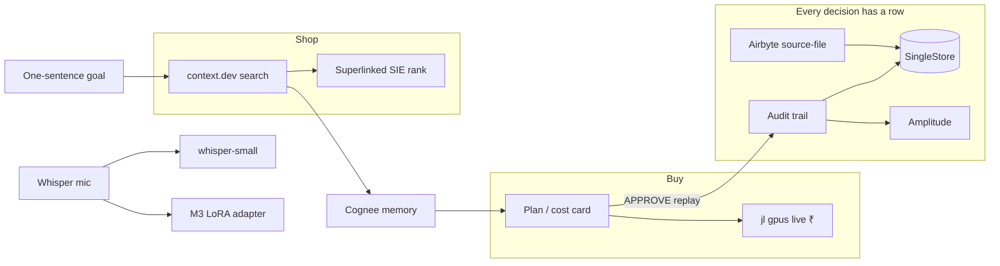

# vibetuning

A personal agent that shops for **datasets + GPU compute**, buys a LoRA, and leaves a row for every decision.

> context.dev discovers data anywhere; Airbyte ingests it from 700+ sources; every training row lands in SingleStore with lineage — audit trail from prompt to weights.



## Why each tool

| Tool | Role | Why this one |
| --- | --- | --- |
| **context.dev** | Discover datasets on the live web | The agent has to shop, not assume Expresso. |
| **Cognee** | Agent memory of *our* runs | Quotes the M1 **1.84×** cold overhead and the M3 **warm-resume** lesson before it prices a GPU. |
| **Superlinked SIE** | Rank discovered datasets to the task sentence | Stretch; flag-off if no `SIE_API_KEY`. |
| **Airbyte** | Ingest the curated manifest | Lineage for every training row (not search). |
| **SingleStore** | `runs` + `events` + `training_rows` | The audit DB. MySQL wire. SQLite fallback so the demo never blanks. |
| **Amplitude** | HTTP v2 mirror of the same events | Funnel of the M3 run. |
| **Statsig** | One runtime flag | `warm_resume_enabled` and/or `budget_cap_inr` actually read before the quote. |
| **JarvisLabs `jl`** | Live L4 ₹/hr + the real M0–M3 training | Already ran. Demo **does not retrain**. |
| **Gradio** | Three-tab demo on vibetuner | Sentence → card → approve → audit → live ASR. |

## The audit-trail story

Every decision has a row in `events(run_id, ts, event, payload, cost_inr, wer)`:

`search` → `dataset_built` (license on the row) → `plan_shown` (₹ quote) → `approved` → `train_start` → `train_end` (WER) → `paused` (0 running) → `cost_delta` (predicted vs actual).

M3 receipt: **₹9.9 predicted vs ₹5.24 actual**. WER **7.83% → 7.17%**. Pause proof is a row, not a screenshot.

## Built today vs already there

**Pre-existing core (M0–M3, do not retrain)**

- Boat sandbox `vibetuner`, JarvisLabs L4 jobs, Expresso forge (`ylacombe/expresso`, CC BY-NC 4.0)
- whisper-small LoRA at `artifacts/m3/adapter/`
- Probe + full-run cost cards, `run_spec.json`, WER protocol

**Built today (hackathon demo)**

- Cognee memory over progress/cost/license docs
- SingleStore (or SQLite) audit + M1/M3 backfill
- Airbyte `source-file` → `training_rows` lineage (pandas fallback)
- Amplitude HTTP v2 + Statsig runtime flag
- Superlinked SIE rank (stretch, flagged)
- Gradio: Vibe-tune / Whisper / Audit trail

## Demo

```bash
python -m venv .venv
.venv\Scripts\activate   # Windows
pip install -r requirements-demo.txt
copy .env.example .env   # paste hackathon keys; flags default safe
python app.py      # Gradio, :7860
python server.py   # mission control, :7861
```

1. **Vibe-tune** — task sentence → research (context.dev + cognee) → plan/cost with live `jl gpus` ₹ and cold/warm overhead → **APPROVE** replays M3 (no GPU).
2. **Whisper** — mic/file, base vs adapter. GPU serving fallback is `WHISPER_GPU_FALLBACK=1` with a **₹20** cap, paused after.
3. **Audit trail** — lineage header + M3 timeline.

Ask memory: *what did we learn about GPU cost estimation?* It should return M1 **1.84×** and M3 warm-resume **₹5.24 vs ₹9.9**.

### Mission control (single page, :7861)

`python server.py` serves `web/index.html`. It's a FastAPI wrapper over the same `agent/*` calls, and the Gradio app stays on :7860 as fallback.
- `POST /api/run` streams each step over SSE: parse → cognee → context.dev → SIE → license → ingest → jl price → quote. Every step is a real call or is labelled *flag off* / *fallback*.
- `POST /api/approve` streams the M3 audit rows, labelled **REPLAY**.
- Streams resume via `GET /api/streams/{id}?after=N`.
- `/api/spend`, `/api/status`, `/api/audit` and `/api/memory` feed the drawers. `/api/transcribe` feeds the whisper A/B (CPU torch needed).
- No secrets leave the server.

## Flags

Every integration degrades. `COGNEE_ENABLED`, `SINGLESTORE_ENABLED`, `AIRBYTE_ENABLED`, `AMPLITUDE_ENABLED`, `STATSIG_ENABLED`, `SUPERLINKED_ENABLED`, `WHISPER_GPU_FALLBACK`. Missing keys → off. The demo still runs.

## License note

Training audio is **CC BY-NC 4.0** (Expresso). Demo and agent code in this repo: see commit history. Do not use the adapter commercially.
